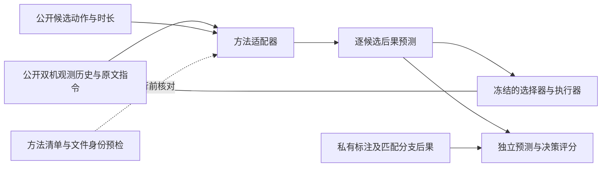

# 统一模型适配与运行设施设计

主线：在部分可观测、队友行为变化的环境中，评测双无人机协作技能和世界模型预测能力能否组合迁移到新任务。

截图中“将模型包装为统一接口的适配器和运行基础设施”的思路适用。这里采用这一
分层原则，复用仓库现有协议；没有引入或复现 XPolicyLab，也不将建设通用模型平台
另立为研究目标。设施要让不同方法在相同信息权限、任务和预算下可追溯地比较。

## 数据流与职责



图中的预测/选择闭环是目标设计，尚未全部接线。候选动作只送给预测接口；动作型
基线直接输出双机动作，不能由设施自动补成候选成功概率。私有结果只进评分器，
不经适配器回传策略；文件目录分离尚不等于操作系统访问隔离。

| 层 | 已有实现 | 本次及后续工作 |
| --- | --- | --- |
| 输入与输出协议 | ModelObservation、GroundedAction、DecisionRequest/Prediction | 本次复用并按声明类别离线检查，不合并成含糊的“通用输出” |
| 方法身份与配置 | 既有checkpoint身份、若干模型专用诊断 | 本次新增adapter_manifest，统一登记来源、转换组件、训练声明及文件哈希 |
| 模型服务 | adapter_server的工厂/TCP及可选清单诊断服务 | 已绑定入口源码与服务进程；完整依赖/权重消费、进程监督及评测接线仍待完成 |
| 场景与控制 | 旧固定角色runner、未解锁启动证据与时钟门控 | 后续单独接角色自由任务/技能执行器；不把旧runner改名当作完成 |
| 预测与决策评分 | candidate_scoring独立离线评分 | 后续提供真实同起点匹配分支，不能用set_pose或合成标签代替 |

不重新实现模型网络或为每个模型复制runner。模型特有的分词、视觉编码、原生输出
解释和动作转换属于适配器；任务定义、候选后果标注、评分和安全控制属于公共设施。
模型若依赖自己的规划器，规划器及配置属于参评方法，另行登记，不冒充公共选择器。

## 统一信息权限和角色边界

当前登记profile为 `centralized_dual_rgb_local_flu_unassigned/1-draft`：集中式双RGB、
原文指令、各机起飞局部FLU状态及允许的动作/消息历史。原有图片为256×256 RGB JPEG，
局部原点不同，不能直接相减为共同世界坐标。通信暂不受限；有限视野、遮挡及历史
依赖仍须在真实任务中实现并验证，允许读取历史不证明模型使用了历史。

预测接口另有观测序列、候选双机动作、各步时长和公共任务类型，不含目标世界坐标、
标签图、真实候选收益、障碍物地图、未来轨迹或私有队友条件身份。深度、BEV、点云、
共同全局位置和任务预分配角色均不属于当前profile；有这些原生需求的方法先判不兼容，
不能由适配器悄悄生成真值。将来若开新模态轨，需要独立权限和可比较方法集合。

任务不指定固定发现者/确认者、高低空或机号职责。清单的 `policy_role_binding` 可为
unassigned、method_fixed、unknown；固定分工是方法属性，允许如实登记，不能因此
给公共任务加角色答案。登记unassigned也不证明模型学会动态分工。新profile的保存
响应预检拒绝旧 `intent=handoff/confirm` 固定方向映射；逐机视觉事件仍经GroundedAction
记录，由角色自由任务评分。没有把该限制反写到旧兼容协议。

## 本次实现：声明清单与离线预检

`adapter_manifest.py` 使用 `aerowam-adapter-manifest/1-draft`。输入是明确选择的JSON，
不会自动扫描/注册第三方仓库或把已有模型名假定为接入成功。

| 清单字段 | 必须说明的事实或声明 |
| --- | --- |
| method_id、implementation | 独立方法版本；external_model / repository_model / rule_policy / transport_example |
| factory、interface | module:function；joint_action / grounded_action / candidate_prediction |
| input_profile、required_inputs | 固定信息profile及所需字段；不支持的输入拒绝 |
| policy_role_binding | 方法自身的角色偏好，不是任务角色配置 |
| source | repository、revision、license、native_output、adaptation；未知许可证如实写unknown |
| components | language_encoder、planner、reporter、action_decoder的版本/来源，或明确none/unknown |
| training | status、data_id、seed、steps、trainable_parameters；未知数值为null，不编造0 |
| runtime | device、precision、history_usage；历史使用声明为current_only / explicit_history / stateful / unknown |
| artifacts | 每份文件的id、kind、path、sha256；按原始字节流式哈希，不加载权重 |

真实模型须列adapter_code、weights、config、environment四类文件；规则策略不需weights，
但要配置及环境文件。environment是依赖锁定/环境导出文件，不表示已安装验证。
transport_example只要求代码，避免给悬停示例编造模型权重。多分片权重/辅助头须逐项
登记；工具核验列出的文件，不会证明清单已列全所有加载依赖、来源真实或获得许可。
相对文件路径以清单所在目录为基准，绝对路径也可；同文件重复列出或目录代替文件拒绝。
哈希按文件原始字节计算，换行转换也会改变身份，不自动“修复”已登记文件哈希。

预检拒绝未知/缺失字段、重复JSON键、非法训练数值、重复工件、不匹配哈希，以及
不属于当前RGB权限的输入需求。factory只检查字符串语法，不导入或执行；验证通过
并不证明它可加载、实际加载了这些文件或模型输出对应这份清单。

```bash
python3 -B -m benchmark.px4_gazebo.model_handoff.adapter_manifest \
  --manifest /absolute/path/to/method_manifest.json \
  --output /absolute/path/to/new_preflight.json

# 可另外核验一对已保存的公开请求/原生契约响应，二者须同时提供。
python3 -B -m benchmark.px4_gazebo.model_handoff.adapter_manifest \
  --manifest /absolute/path/to/method_manifest.json \
  --request /absolute/path/to/public_request.json \
  --response /absolute/path/to/saved_response.json \
  --output /absolute/path/to/new_contract_preflight.json
```

保存对检查复用图片解码、逐候选覆盖和概率校验；grounded响应核对报告所属机号及
当前图片stamp，动作不得静默限幅。它不生成缺失bbox、found/confirm、后果概率或
utility；动作菜单选择不具备预测输出时不能注册为candidate_prediction接口通过。
接口结构通过仍不能证明动作正确、目标身份真实、预测准确或曾经调用了模型。

报告为 `aerowam-adapter-preflight/1-draft`，绑定清单及保存请求/响应的SHA256，输出
manifest_files_verified和saved_io_verified。工厂导入、实际模型执行、运行时延、清单
完整性、访问隔离、角色自由执行、预测质量、flight_ready及formal_benchmark_result
始终为false；本工具不认证这些事项。输出独占创建，失败不覆盖原报告；清单与报告
可能含本地路径、训练来源和配置，真实记录留私有数据区，不自动上传。

## 已实现的清单服务诊断模式

`adapter_server --manifest` 现可将上述清单接到一个实际Python服务进程；
`--factory`旧入口保持原有行为，不自动取得新身份或隔离声明。新入口示例：

```bash
python3 -B -u -m benchmark.px4_gazebo.model_handoff.adapter_server \
  --manifest /absolute/path/to/method_manifest.json \
  --entry-artifact factory_entry \
  --run-dir /absolute/path/to/new_private_run \
  --host 127.0.0.1 --port 8765
```

factory_entry必须是清单中定义工厂函数的adapter_code文件ID。新目录独占创建；
先核验全部已列文件，再读取并保存入口源码原始字节，显式compile/exec这些字节。
不复用旧pyc，也不接受已经导入的同名入口模块或从别处重导出的工厂函数。
支持本地定义的无参数Python函数工厂，返回可调用对象；不是任意二进制模块加载器。
factory执行完后再核验一次清单/已列文件，变化或初始化失败均不开放服务。

私有运行记录包含：

- `preflight.json`：初始化前的清单、身份核验与声明；早期核验失败时可能不存在。
- `entry_source.py`：此次实际编译的入口源码快照及startup中的SHA256。
- `startup.json`：工厂成功后记录实际PID、解释器、平台、包元数据、入口身份与加载耗时。
- `events.jsonl`：启动、监听、调用/失败及可执行到的关闭事件；请求/响应按排序紧凑JSON
  计算哈希，不保存为“已执行动作”或“已评分后果”。调用审计IO失败会封锁后端复用；
  这不认证所有传输诊断事件都能成功落盘。

工厂、依赖导入和初始化允许执行所选代码，不能把“入口源码身份绑定”解释为系统
访问隔离或所有依赖被认证。配置、环境、权重工件在这里核验的是已列文件身份，
不证明工厂实际消费了它们，也不自动注入配置或安装依赖。包元数据不是实际GPU
执行证据，工厂耗时不是在线推理时延。本层不额外调用warm-up或reset。

服务以第一条有效请求绑定episode_id，换episode必须新建服务进程；这避免跨任务
复用本进程的策略记忆，但不是学习模型状态或其子进程被完整恢复的证明。整个TCP
交换及后端调用均拒绝并发排队；先按声明校验请求，再把副本传给工厂返回的策略。
返回值对照原请求校验，策略修改自己的请求副本不能篡改图片stamp或候选来通过检查。

新传输路径的收包、校验、后端调用及发送共享400ms服务侧预算，客户端原400ms
完整调用预算保持不变。坏包、跨episode和忙碌拒绝不调用后端；后端异常、无效响应、
调用超时或响应发送失败后封锁复用，不补动作/视觉报告。服务不能取消任意Python
后端，超时计算可能继续；它完成后也不能再提供响应或处理下一次模型调用。
关闭时另记backend_active_at_close、backend_cancelled=false，不误报已取消或进程已退出。
完整端到端时限认证、外部进程监督/取消与真实模型GPU计时仍未实现，flight_ready始终false。

新增25项合成运行回归，加上此前67项，Windows/WSL各92项通过，原interface_self_test
在两端仍通过。测试含真实本地TCP与独立CLI子进程、旧字节码、源码/配置漂移、
请求副本篡改、单episode、超时/发送失败、坏包及后台执行中关闭。超时坏包既可关闭
连接，也可在剩余预算内返回明确错误；两种结果都须保证未执行后端。

另在两端各用一次既有悬停传输示例的独立服务做完整验证，复用上一节的清单及明确
合成输入。实际PID、编译源码SHA、两次空报告/悬停响应和跨episode执行前拒绝均核对，
清单和已列文件未变。私有目录：`D:/AeroWAM-data/adapter_runtime_20261018_v1/`。
入口源码SHA256为 `b695c84924439c9eaca2d2287bb3ced7e9435335d3a3b37ca6063e19171c0486`。
两端身份与契约一致，PID、平台、时延和退出方式分别记录：WSL通过SIGINT正常关闭，
Windows由监督脚本terminate自有进程，返回1且没有service_closed事件，未将其描述为
优雅退出。两端自有进程均wait确认停止，没有运行真实模型、仿真、训练或任务评分。

## 运行设施的后续接线设计

以下是整体接线要求；上述入口源码/诊断服务部分已实现，其余不据此标成完成：

1. 运行器显式选择清单和冻结的任务/评分版本，启动前复核文件；用参数数组启动
   独立模型进程，不执行清单里的shell命令，不自动安装依赖或修改仿真/时间服务。
   实际解释器、包/驱动/GPU、源文件/权重身份、启动命令及配置另存运行记录。
2. 将清单声明与真实加载代码/文件绑定，验证reset(episode_id)或每episode新进程。
   有状态模型串行推理，禁止跨episode混入记忆；cold、显式warm-up和复用调用分别
   记录，warm-up不得读取留出任务答案。多模型进程隔离不等于访问隔离，后者需独立验证。
3. 客户端保留400ms完整调用预算，包含排队、发送、预处理、推理和分段接收。
   GPU完成需同步计时，加载/初始化另记；不以最好一次或仅生成阶段冒充端到端时延。
   超时返回明确失败，不补悬停/报告，不重复发送动作；超时后仍计算的进程须确认
   停止或隔离后才能接收下一请求，不能让后台旧响应改变下一次状态。
4. 双机角色自由技能执行器记录请求、限幅/变换后发布、真实接收状态与失败原因。
   模型失败、基础设施失败、无效证据、超时、弃权分别保存；任务成功不能覆盖质量失败。
   原有10ms时钟门槛和安全路径保留，权限或时间不合格的数据不晋升训练/配对分支。
5. 预测轨先固定候选提供者、窗口、执行器和后续策略，所有方法收到同一候选集合。
   实际预测与匹配分支结果交独立candidate_scoring；先证明预测/排序可评分，再接
   短窗口闭环。不把单纯格式通过、动作选择、图像质量或旧交接成功率解释成组合迁移。

旧batch.RunSpec仍只支持三个内置方法；本次没有解除限制，也没有把任意外部模型
自动接入旧固定角色批处理。新角色自由运行器可复用这层清单，但须独立完成上述接线。
不扩大采集或训练，正式组合留出、任务验收和预算冻结仍按既有主线设计推进。

## 前一阶段：离线清单预检验证范围

新增19项合成回归，连同角色自由、grounded传输及候选评分回归，Windows/WSL各67项
通过。覆盖文件漂移/缺失、声明越界、三类接口分离、双方视觉事件、旧方向intent拒绝
及输出不可覆盖。合成权重/预测只用于测试，未训练或运行真实模型、未启动仿真。
当前真实启动环境仍被连续时钟门控拒绝，见STARTUP_EVIDENCE_CN.md；本设计不绕过它。

另用既有悬停传输示例登记3份真实代码文件，并配明确标注的合成JPEG请求和空报告
响应，在Windows/WSL分别通过正式CLI。两端解析后的JSON报告完全一致（文件换行
格式可不同），manifest_files_verified及saved_io_verified为true，所有模型执行、
运行时延、能力和飞行声明仍为false。没有调用示例factory或任何真实模型。
私有复核目录为 `D:/AeroWAM-data/adapter_preflight_20261018_v1/`，清单SHA256：
`da67b8de4ecbd0dfb3244ee61547ee6c48f2967aed1a60402651e92f24d41a72`。
原interface_self_test的实际本地TCP回环也在两端通过。没有注册可用外部模型或
取得角色自由多任务闭环、候选预测准确率及组合迁移成绩。
